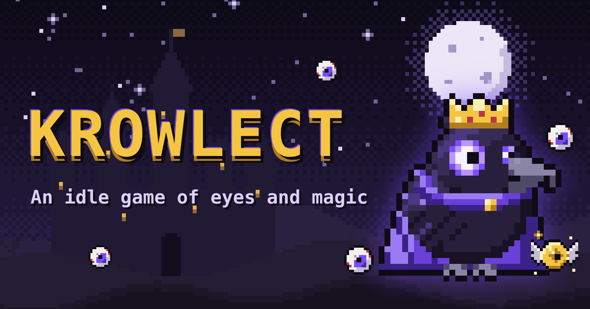

# Krowlect



A medieval idle/clicker game in pixel art. You are the Raven King: collect eyes, turn them into mana and grow a kingdom of ravens until the Eclipse resets everything for a permanent bonus.

**Play:** [victorvk.com/game](https://victorvk.com/game/) · English and Português (BR)

## Features

- 10 buildings, 62 upgrades, 4 spells, a market with consumables and king skins, 35 achievements
- **Omens:** a golden eye that flies across the screen with random rewards
- **Eclipse:** prestige reset that pays in Black Feathers, with a cinematic sequence
- Offline progress, save export/import
- **Raven Account:** cloud save on any device and a top-50 leaderboard
- Generated sound effects and ambient music, `prefers-reduced-motion` support, mobile-first layout

## How it's built

- **No dependencies, no bundler.** Vanilla ES modules, HTML and CSS, served as static files.
- **Pixel art made in code.** Sprites are text grids in `tools/build_sprites.py`, generated into `js/art/sprites.js` with palette-swapped skins.
- **Content as data.** Everything the player can buy or unlock lives in `js/data/config.js`. The engine (`js/economy.js`) only knows effect types.
- **Save system.** Versioned saves with migrations (`js/state.js`). Only one tab owns the save at a time.
- **Cloud API** on a Cloudflare Worker + D1 (`/worker/index.js` in the repo root): PBKDF2 passwords, per-IP rate limits, server-side checks on save values, "newer progress wins" enforced in the database write, and hourly backups per account.
- **Balance tools.** `tools/sim.mjs` simulates a player to check pacing; `tools/test-economy.mjs` tests the economy math.

## Run locally

```bash
cd public/game
python3 -m http.server 8000     # open http://localhost:8000
node tools/sim.mjs              # pacing simulation
node tools/test-economy.mjs     # economy tests
```

The game runs without the API (local save only). Architecture notes: [ARCHITECTURE.md](ARCHITECTURE.md) · Changes: [CHANGELOG.md](CHANGELOG.md)
